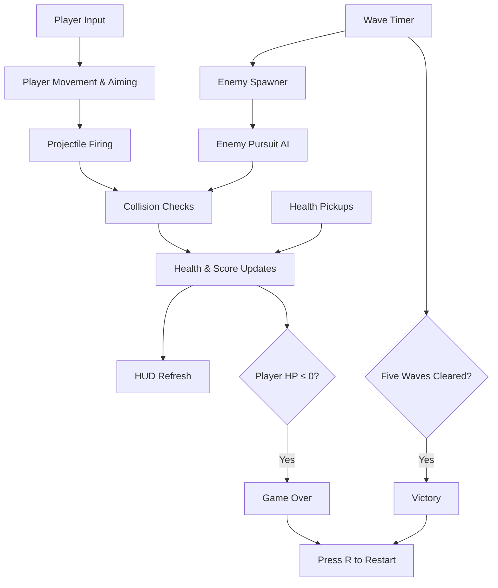

<div align="center">

# ⚡ NEON SURVIVOR

### SURVIVE THE WAVES. OUTLAST THE CHAOS.

A neon-soaked, top-down survival shooter built with **Godot 4.x** and **GDScript**.

[](https://godotengine.org/)
[](https://docs.godotengine.org/)
[](#gameplay)
[](LICENSE)

**Move fast. Aim true. Survive five waves.**

<!-- Replace the preview below with a real gameplay GIF when available. -->
<p>
  
</p>
<sub>Gameplay preview — add your recorded clip at <code>assets/gameplay/gameplay.gif</code>.</sub>

</div>

---

## 🎮 The Game

Neon Survivor is a compact 2D arena survival game. Enemies continuously close in on the player, and every wave raises the pressure. Move around the arena, aim with your mouse, eliminate threats, and collect health pickups to stay alive.

The current build contains **five timed waves**, a score system, health management, a live HUD, and both Victory and Game Over states.

## ✨ Features

| Feature | What it does |
|---|---|
| **Responsive movement** | Move with WASD or the arrow keys |
| **Mouse aiming** | Aim and fire toward the cursor |
| **Enemy pursuit AI** | Enemies track and move toward the player |
| **Wave progression** | Survive five 25-second waves |
| **Combat system** | Fire projectiles and eliminate enemies |
| **Health system** | Take contact damage and restore health |
| **Health pickups** | Collect green pickups to recover 25 HP |
| **Scoring** | Earn 100 points for each defeated enemy |
| **Live HUD** | Monitor health, score, wave, and remaining time |
| **Game states** | Reach Victory or Game Over; press R to restart |

## 🕹️ Controls

| Input | Action |
|---|---|
| `W` `A` `S` `D` | Move |
| `↑` `←` `↓` `→` | Move |
| Mouse | Aim |
| Left mouse button (hold) | Shoot |
| `R` | Restart after Victory / Game Over |

## 🚀 Getting Started

### Requirements

- [Godot Engine 4.x](https://godotengine.org/download/) (project configured for Godot 4.3)
- Windows, macOS, or Linux

### Run locally

1. Clone this repository:
   ```bash
   git clone https://github.com/<your-username>/neon-survivor.git
   ```
2. Open **Godot Project Manager**.
3. Select **Import** and choose the cloned folder's `project.godot`.
4. Open the project and press **F6** to run the main scene or **F5** to run the project.

No external plugins or third-party assets are required by the current project.

## 🧠 How It Works

The game is implemented in a single main scene and a GDScript controller. The controller updates player movement, projectiles, enemies, pickups, wave timing, collisions, score, and game-state transitions.



### Project layout

```text
Neon-Survivor/
├── assets/
│   ├── branding/       # Logo and visual identity assets
│   ├── gameplay/       # Gameplay GIFs and video previews
│   └── screenshots/    # In-game screenshots
├── docs/
│   ├── ARCHITECTURE.md
│   └── DEVELOPMENT.md
├── Main.tscn           # Main game scene
├── main.gd             # Gameplay logic and rendering
├── project.godot       # Godot project configuration
├── CHANGELOG.md
├── CONTRIBUTING.md
├── LICENSE
└── README.md
```

## 🖼️ Screenshots

Add real screenshots from your running build to `assets/screenshots/`, then update this section.

| Arena | Combat | Victory |
|---|---|---|
| `assets/screenshots/arena.png` | `assets/screenshots/combat.png` | `assets/screenshots/victory.png` |

## 🛠️ Built With

- **Godot Engine 4.x** — 2D game engine and runtime
- **GDScript** — gameplay logic
- **Godot 2D drawing API** — neon arena, player, enemies, projectiles, pickups, and HUD

## 🗺️ Roadmap

- [ ] Record and add a gameplay GIF
- [ ] Add polished screenshots and a custom title/logo graphic
- [ ] Add sound effects and background music
- [ ] Add a main menu and settings
- [ ] Introduce additional enemy types
- [ ] Add weapon variety and upgrade drops
- [ ] Add a boss encounter
- [ ] Save local high scores

Roadmap items are ideas for future versions, not features in the current build.

## 🤝 Contributing

Ideas, bug reports, and improvements are welcome. Read [CONTRIBUTING.md](CONTRIBUTING.md) before opening a pull request.

## 📄 License

This project is released under the [MIT License](LICENSE).

---

<div align="center">

**Built with ⚡, GDScript, and a little bit of chaos.**

</div>
